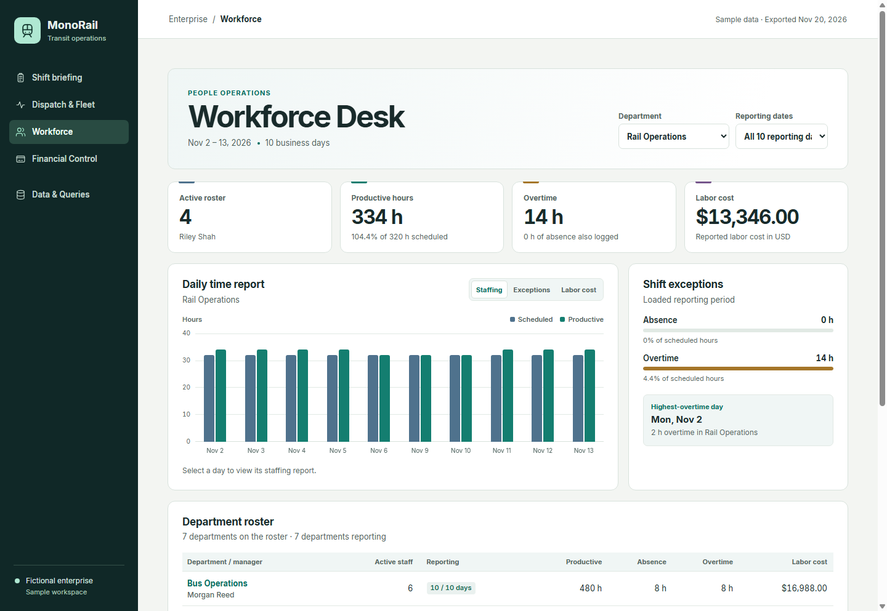

# Operations dashboards

Start with **Shift Briefing** and follow an item into the desk that owns it. [Download the offline dashboard](operations/index.html) from GitHub and open the HTML file in a browser. In a local clone, open `dashboards/operations/index.html` directly.

| Desk | Use it to |
| --- | --- |
| Shift Briefing | Review flagged service, fleet, spending, and staffing items before the shift. |
| Dispatch & Fleet | Compare route outcomes by day and review the critical repair queue. |
| Workforce | Filter hours and labor cost by department and reporting date. |
| Financial Control | Review department variance, pending approvals, and monthly budget coverage. |
| Data & Queries | Inspect reporting windows, quality outcomes, and the Malloy behind the numbers. |



## Refresh the snapshot

The dashboard opens offline. The extract uses [enterprise.malloy](../models/malloy/enterprise.malloy) for company data and [cta.malloy](../models/malloy/cta.malloy) for the schedule cross-check.

With Node.js 22 or newer and an authenticated Google Cloud CLI account that can query `monorail-sample`, run these commands:

```sh
cd dashboards/operations
npm ci
npm run refresh
```

Refresh runs the Malloy queries against the warehouse, writes `snapshot.json`, and rebuilds the offline `index.html`. To rebuild the HTML from the existing snapshot, run `npm run build`. Commit the snapshot and HTML together when publishing a new dashboard revision.
